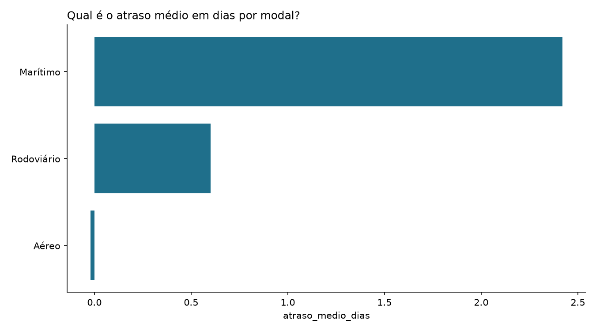

# Pergunte ao Comex

[](https://github.com/sbarbosa25/pergunte-ao-comex/actions/workflows/ci.yml)

Faça uma pergunta em português sobre uma operação de comércio exterior e receba a resposta em tabela e gráfico. O projeto foi desenhado para uma IA escrever o SQL, o DuckDB executar e uma avaliação automática medir, a cada commit, se a IA continua acertando.

**A IA é opcional e este repositório não tem chave de API configurada.** Tudo o que aparece rodando aqui (a página, o modo demonstração e o CI) usa SQL de gabarito escrito à mão, sem chamar modelo nenhum. Quem quiser ver a IA respondendo perguntas livres usa a própria chave, como descrito em [Onde a IA entra](#onde-a-ia-entra).

Exemplo de uso no modo demonstração (os números são os da base deste repositório):

```
$ pergunte-comex --demo "Qual é o atraso médio em dias por modal?"

Modo demonstração (sem IA). Pergunta reconhecida: Qual é o atraso médio em dias por modal?

SQL:
SELECT modal, round(avg(dias_atraso), 2) AS atraso_medio_dias
FROM processos
WHERE status <> 'Cancelado' AND dias_atraso IS NOT NULL
GROUP BY modal ORDER BY atraso_medio_dias DESC

modal       atraso_medio_dias
----------  -----------------
Marítimo                 2,42
Rodoviário               0,60
Aéreo                   -0,02

Gráfico salvo em saida/resposta.png
```



## Teste agora, sem instalar nada

**[Abrir a demonstração no navegador](https://sbarbosa25.github.io/pergunte-ao-comex/)**

A página traz as 15 perguntas do catálogo, cada uma com gráfico, tabela e o SQL executado. Dá para clicar em uma pergunta ou digitar a sua. Ela é uma demonstração sem IA: os resultados foram calculados na publicação, a partir da mesma base e dos mesmos SQLs de gabarito usados na avaliação.

## Teste em 1 minuto no terminal, sem chave de IA

Não precisa de conta nem de chave de API para experimentar. O modo demonstração responde a partir do mesmo catálogo de 15 perguntas:

```bash
git clone https://github.com/sbarbosa25/pergunte-ao-comex.git
cd pergunte-ao-comex
pip install -e .

pergunte-comex --demo                              # menu com as 15 perguntas
pergunte-comex --demo "atraso médio por modal"     # ou pergunte direto
```

Na primeira execução o banco é criado sozinho. O modo demonstração não usa IA: ele encontra no catálogo a pergunta mais parecida com a digitada e roda o SQL de gabarito dela. Todo o resto é o caminho real (trava de segurança, consulta no DuckDB, tabela e gráfico). Perguntas livres, fora do catálogo, precisam da IA e estão descritas em [Onde a IA entra](#onde-a-ia-entra).

O projeto junta três coisas que costumam aparecer separadas em portfólio: engenharia de dados (geração da base, ETL, validações), IA aplicada (linguagem natural para SQL, com travas de segurança) e fluxo de trabalho em Git (branches, pull requests e CI no GitHub Actions).

## Como funciona

```
dados/processos_comex.csv     base bruta, 1000 processos, "suja" de propósito
        |
        v  python -m pergunte_comex.etl
dados/comex.duckdb            tabela `processos`, limpa, com colunas derivadas e validada
        |
        v  pergunte-comex "..."
pergunta -> IA escreve o SQL -> trava de segurança -> DuckDB -> tabela + gráfico
```

| Etapa | Arquivo | O que faz |
| --- | --- | --- |
| Base de exemplo | `src/pergunte_comex/gerar_base.py` | Gera 1000 processos sintéticos com semente fixa |
| ETL | `src/pergunte_comex/etl.py` | Limpa o CSV, deriva colunas e roda 8 validações |
| Dicionário de dados | `src/pergunte_comex/esquema.py` | Descrição das colunas, usada pelo ETL e pela IA |
| IA | `src/pergunte_comex/ia.py` | Monta o prompt e pede o SQL ao modelo |
| Demonstração | `src/pergunte_comex/demo.py` | Responde sem IA, a partir do catálogo de perguntas |
| Página web | `src/pergunte_comex/pagina.py` | Gera o HTML da demonstração publicada no GitHub Pages |
| Segurança | `src/pergunte_comex/sql_seguro.py` | Só deixa passar um SELECT |
| Consulta | `src/pergunte_comex/responder.py` | Executa em conexão somente leitura, com teto de linhas, tempo, memória e disco |
| Saída | `src/pergunte_comex/saida.py` | Tabela no terminal e gráfico em PNG |
| Avaliação | `avaliacao/` | 15 perguntas com gabarito e o avaliador |

## A base de dados

A base é sintética. Ela simula a carteira de processos de um agente de carga fictício entre janeiro de 2025 e setembro de 2026: importações e exportações nos modais marítimo, aéreo e rodoviário, com cliente, transportador, rota, produto (NCM), valores em dólar, datas de cada etapa, canal de parametrização e status. Clientes, transportadores e valores foram inventados e não representam nenhuma empresa real.

O CSV sai do gerador como uma exportação de sistema costuma chegar: separador ponto e vírgula, decimal com vírgula, datas em dd/mm/aaaa e textos com caixa e espaços inconsistentes (`MARÍTIMO`, ` Verde  `). Arrumar isso é trabalho do ETL, que também calcula `valor_cif_usd`, `dias_transito`, `dias_atraso`, `atrasado`, `dias_desembaraco` e `pais_parceiro`.

A semente é fixa, então `python -m pergunte_comex.gerar_base` sempre produz o mesmo arquivo. O CI confere isso.

## Como rodar

Requer Python 3.11 ou mais novo.

```bash
git clone https://github.com/sbarbosa25/pergunte-ao-comex.git
cd pergunte-ao-comex
pip install -e ".[dev]"

python -m pergunte_comex.etl        # cria dados/comex.duckdb
pytest                              # roda os testes
pergunte-comex --exemplos           # lista as perguntas do catálogo
```

Nada disso usa IA nem chave de API.

## Onde a IA entra

A IA tem um papel só: traduzir a pergunta em SQL (`src/pergunte_comex/ia.py`). O que vem antes e depois (ETL, trava de segurança, consulta, tabela e gráfico) é o mesmo código com ou sem ela.

| | Sem chave | Com chave própria |
| --- | --- | --- |
| Página de demonstração | funciona | funciona |
| `pergunte-comex --demo` | funciona, 15 perguntas do catálogo | funciona |
| `pergunte-comex "pergunta livre"` | não roda, indica o modo demonstração | a IA escreve o SQL |
| Testes e CI | rodam | rodam |
| Avaliação da IA (`--ia`) | não roda | mede o acerto nas 15 perguntas |

Este repositório fica na coluna "sem chave", por escolha: é público e o uso da API é cobrado. A consequência é que a chamada real ao modelo e a avaliação da IA ainda não foram executadas aqui, então não há taxa de acerto publicada. O caminho da IA é coberto pelos testes com um gerador falso que segue o mesmo contrato do gerador real.

Para usar a IA na sua máquina, com uma chave da API da Anthropic:

```bash
export ANTHROPIC_API_KEY="sua-chave"
pergunte-comex "Quais os 3 clientes com maior valor CIF total?"
```

O modelo padrão é `claude-sonnet-5-5`. Para trocar, use `--modelo` ou a variável `PERGUNTE_COMEX_MODELO`. A chave fica só no seu ambiente; não a coloque em arquivos do repositório.

## Segurança do SQL gerado

O SQL vem de um modelo de linguagem, então ele é tratado como entrada não confiável. Quatro barreiras independentes ficam entre a IA e o banco. As três primeiras controlam o que a consulta pode fazer; a quarta, quanto ela pode custar:

1. `sql_seguro.validar` aceita um único comando, que precisa ser `SELECT` ou `WITH ... SELECT`, e recusa palavras de escrita e funções de leitura de arquivo.
2. A conexão com o DuckDB é aberta em modo somente leitura.
3. O acesso externo do DuckDB é desligado antes da consulta, então nenhum SQL consegue ler arquivos do disco.
4. A consulta tem teto de custo: no máximo 10.000 linhas lidas, 10 segundos de execução (um temporizador chama `con.interrupt()`), 512 MB de memória e 1 GB de arquivos temporários em disco. Um `SELECT` válido com produto cartesiano passa pelas três primeiras barreiras e para nesta.

A quarta barreira nasceu de uma revisão pública do projeto feita por Diego Arruda, que apontou que o resultado era lido com `fetchall`, sem limite de linhas nem de tempo, e sugeriu o caminho da correção. Ao testar a correção, uma ordenação sobre um produto cartesiano gravou 24 GB de arquivos temporários em dois minutos, e por isso o teto de disco entrou junto.

## Avaliação automática da IA

`avaliacao/perguntas.json` tem 15 perguntas, cada uma com um SQL de gabarito escrito à mão. O avaliador pede o SQL à IA, roda os dois no mesmo banco e compara os resultados. O que conta é a resposta: nome das colunas, ordem das colunas e ordem das linhas não importam.

```bash
python -m avaliacao.avaliar --gabarito   # confere os gabaritos, sem IA
python -m avaliacao.avaliar --ia         # avalia a IA e gera saida/avaliacao.md
```

O modo `--gabarito` roda em todo commit. O modo `--ia` precisa de chave e ainda não foi executado neste repositório. Ele reprova se o acerto ficar abaixo de 80%. Uma limitação conhecida: a comparação é exata, então uma resposta correta em outro formato (o mês como `2026-01` em vez de data, por exemplo) conta como erro.

## Integração contínua

O workflow `.github/workflows/ci.yml` roda em todo push na `main` e em todo pull request:

- lint com ruff;
- regeneração da base, conferindo que o CSV versionado é o que o gerador produz;
- ETL com as validações;
- testes com pytest;
- conferência dos gabaritos;
- modo demonstração rodando de ponta a ponta, sem chave;
- geração da página de demonstração.

Um segundo workflow, `.github/workflows/pages.yml`, gera a página e publica no GitHub Pages a cada push na `main`. A página nunca é editada à mão: se a base ou um gabarito muda, ela é refeita.

O CI também tem um job que avalia a IA de verdade, e ele está desligado aqui. Ele só roda se o repositório tiver o secret `ANTHROPIC_API_KEY` (Settings, Secrets and variables, Actions); sem o secret, como é o caso, o job é pulado e avisa no resumo. Quem fizer um fork e cadastrar a própria chave passa a ter a taxa de acerto publicada a cada push.

## Próximos passos

- Rodar a avaliação da IA e publicar a taxa de acerto
- Perguntas livres pelo navegador, com a IA respondendo
- Resposta em texto corrido além da tabela
- Mais perguntas na avaliação, incluindo perguntas que a base não consegue responder
- Histórico da taxa de acerto por commit

Desenvolvido por Samuel Reis
